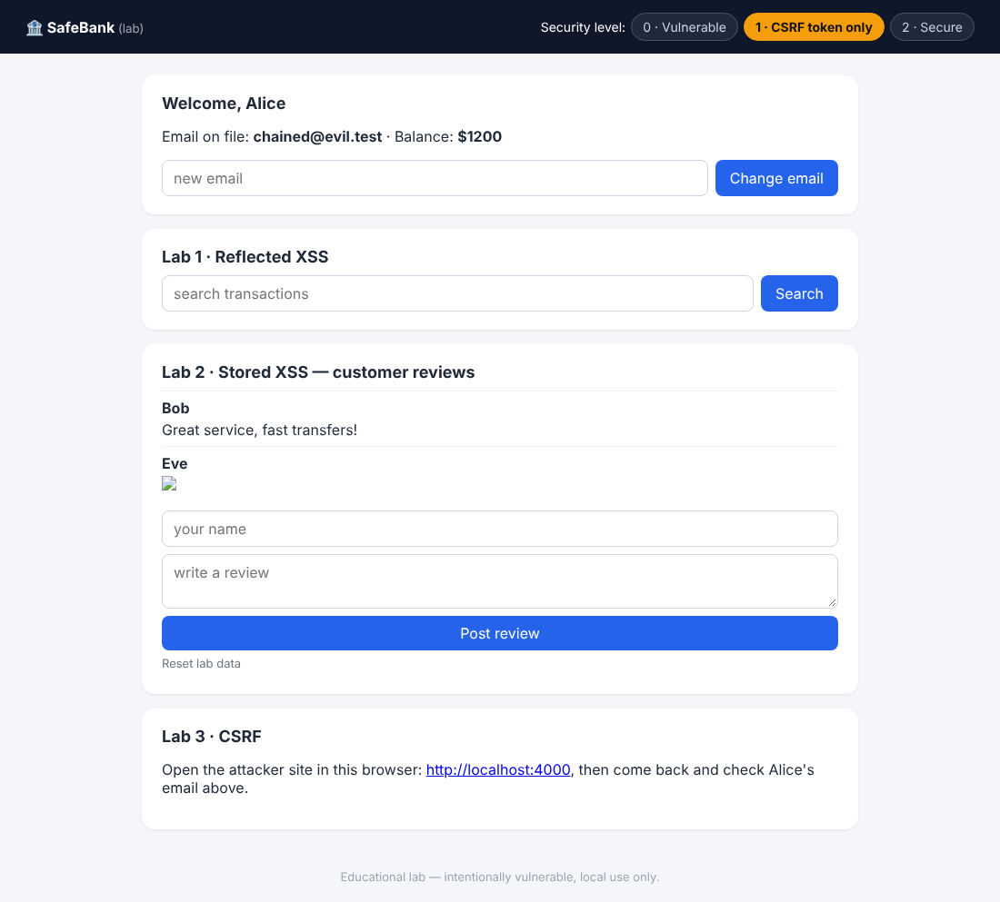

# XSS + CSRF Educational Lab (Demo)

A small, **intentionally vulnerable** web app ("SafeBank") for teaching how Cross-Site Scripting and Cross-Site Request Forgery work, how they chain together, and how to fix them, with a **security-level switch** so students can watch each defense take effect live.

> ⚠️ **For education only.** The app is deliberately insecure. Run it on your own machine; Docker binds it to `127.0.0.1` so it is not reachable from the network. Never deploy it on a public server.



## Run it

```bash
docker compose up --build
```
- Vulnerable app: http://localhost:3000
- "Attacker" site (different origin): http://localhost:4000

Or without Docker: `npm install && npm start`

## Security levels

| Level | Output encoding | CSP | CSRF token | Cookie |
|---|---|---|---|---|
| 0 · Vulnerable | ❌ | ❌ | ❌ | SameSite=Lax |
| 1 · CSRF token only | ❌ | ❌ | ✅ | SameSite=Lax |
| 2 · Secure | ✅ | ✅ | ✅ | SameSite=Strict |

## Walkthrough

**Lab 1 · Reflected XSS** (level 0): search for `<b>hello</b>`. The text renders as bold HTML, which means user input becomes page code. At level 2 it is shown as plain text.

**Lab 2 · Stored XSS** (level 0): post a review such as
``. The script runs for every visitor who opens the page.

**Lab 3 · CSRF** (level 0): open http://localhost:4000 in the same browser, then refresh SafeBank. Alice's email changed to `attacker@evil.test`: the attacker page submitted a hidden form, and the browser attached Alice's cookie automatically. Switch to **level 1** and try again: the request is now blocked (403) because it has no CSRF token.

**Lab 4 · Chaining XSS → CSRF** (level 1): the CSRF token stops other sites, but **not** a script running inside the page. Post this review:

```html

```

The script reads the token from the page and sends a valid request, so the email changes even though CSRF protection is on. **Lesson: XSS defeats CSRF defenses**, so you must fix XSS too. At **level 2**, output encoding and CSP stop the script, and the chain fails.

## Mitigations shown

- **Output encoding** of all user input (the root fix for XSS)
- **Content-Security-Policy** blocking inline scripts (defense in depth)
- **Synchronizer CSRF tokens** on every state-changing request
- **SameSite cookies** (note: in this lab both ports are on `localhost`, which browsers treat as the same site, so the token is what blocks the attack here)
- `HttpOnly` session cookie so scripts can't read it

Built by Saif Aboalnaga.
